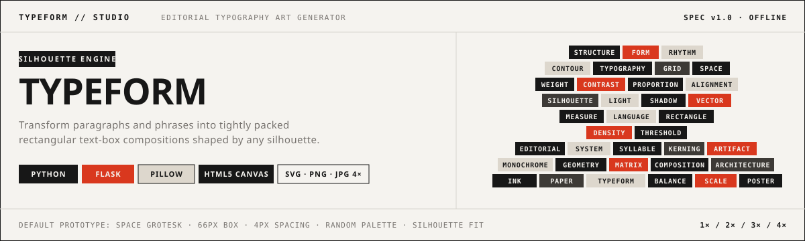

<div align="center">



<br />

# `TYPEFORM` — Minimal Typography Art Studio

**An editorial-grade typographic layout engine that transforms paragraphs, phrases, and repeated words into tightly packed rectangular box-art shaped by any silhouette.**

`PYTHON` · `FLASK` · `PILLOW (PIL)` · `NUMPY` · `FONTTOOLS` · `HTML5 CANVAS` · `VANILLA JS` · `100% OFFLINE`

---

[Overview](#01--overview) ·
[Visual Identity](#02--art-direction--visual-identity) ·
[Processing Pipeline](#03--processing--layout-pipeline) ·
[Layout & Color Modes](#04--layout--color-systems) ·
[Multi-Scale Export](#05--multi-resolution-export-engine) ·
[Quickstart](#06--quickstart--installation) ·
[API Reference](#07--api-specification) ·
[Testing & Security](#08--security--automated-tests)

</div>

---

## `01` / Overview

**TYPEFORM** is a self-contained graphic design instrument engineered to generate Swiss and brutalist editorial typography posters. By combining a real-time **Pillow + NumPy summed-area integral mask pipeline** with **FreeType glyph measurement** and an interactive **HTML5 Canvas viewport**, words pack into geometric rectangles that hug the contours of any uploaded photograph, transparent PNG, or procedural silhouette.

```text
  SOURCE PARAGRAPH                        BINARY MASK                       PACKED TYPOGRAPHY ARTWORK
┌─────────────────────┐               ┌─────────────────┐                 ┌───────────────────────────┐
│ "Typography is the  │               │     ░░░░░░░     │                 │     [TYPE][IS][CRAFT]     │
│  craft of endowing  │      ───►     │   ░░░░███░░░░   │       ───►      │   [ENDOWING][LANGUAGE]    │
│  human language     │   TOKENIZE    │   ░░███████░░   │    O(1) MASK    │   [WITH][DURABLE][FORM]   │
│  with durable..."   │   & MEASURE   │     ░░███░░     │   BOX PACKING   │     [RHYTHM][SPACE]       │
│                     │               │  ░░░░█████░░░░  │                 │  [STRUCTURE][SILHOUETTE]  │
└─────────────────────┘               └─────────────────┘                 └───────────────────────────┘
```

### Core Capabilities

| Capability | Technical Implementation |
| :--- | :--- |
| **Zero External Dependencies** | Built strictly with Python, Flask, Pillow, HTML5, CSS3, and Vanilla JS. No frontend frameworks, no paid APIs, no cloud calls. |
| **$O(1)$ Contour Evaluation** | Uses a 2D cumulative summed-area table (`MaskData.integral`) to evaluate candidate rectangle overlap in constant time. |
| **True Font Measurement** | Measures every word via `PIL.ImageFont.truetype` FreeType metrics + letter tracking before placement so text never clips. |
| **60 FPS Live Canvas** | Interactive `requestAnimationFrame` viewport with zoom (`15%–400%`), pan, fit-to-view, mask overlay, and split `Before / After` slider. |
| **1× to 4× Native Exports** | Generates vector **SVG** (editable `<text>` or converted `<path>` glyph outlines), lossless **PNG** (with alpha), and **JPG** up to `8192 px`. |
| **Session & Local Persistence** | Restores project state across browser refreshes via signed Flask sessions, server-side project records, and `localStorage`. |

---

## `02` / Art Direction & Visual Identity

The studio interface adheres to a strict **monochromatic editorial palette** so user-defined artwork colors remain the sole visual focus.

| Token | Hex | Swatch | Role |
| :--- | :--- | :---: | :--- |
| `--bg-primary` | `#F5F3EF` | `░░░░` | Primary warm off-white paper surface |
| `--text-primary` | `#171717` | `████` | Primary near-black ink, active borders, inverted fills |
| `--text-secondary` | `#77736F` | `▒▒▒▒` | Secondary metadata readouts, section indices, muted labels |
| `--border-color` | `#D8D5D0` | `▬▬▬▬` | Hairline `1px` structural grid dividers and input frames |
| `--surface-inverted` | `#171717` | `████` | Active segmented buttons and primary action triggers |

- **Interface Typeface**: Bundled local `@font-face` **`Neue Machina`** (`Regular`, `Bold`, `Italic`) with **`Space Grotesk`** as the default artwork typeface.
- **Brutalist Geometry**: `0px` border radius across all inputs, buttons, modals, and swatches; text-only controls without decorative icons or gradients.

---

## `03` / Processing & Layout Pipeline

```text
┌─────────────────────────────────────────────────────────────────────────────────────────────────┐
│                                  TYPEFORM EXECUTION PIPELINE                                    │
├──────────────────────┬──────────────────────────┬───────────────────────┬───────────────────────┤
│  1. IMAGE INGESTION  │   2. MASK EXTRACTION     │  3. LAYOUT GEOMETRY   │  4. RENDER & EXPORT   │
│  ─────────────────   │   ──────────────────     │  ──────────────────   │  ──────────────────   │
│  • PNG / JPG / WebP  │   • Alpha channel auto   │  • WordStream tokens  │  • HTML5 Canvas 60fps │
│  • EXIF transpose    │     detection for PNGs   │  • FreeType bbox &    │  • Client-side 0ms    │
│  • Aspect-ratio Fit, │   • Contrast & grayscale │    tracking metrics   │    color updates      │
│    Fill, Crop,       │     threshold (0–255)    │  • Row active spans   │  • Native 1×–4× SVG,  │
│    Stretch, Scale,   │   • Mask inversion       │  • Overlap >= min %   │    PNG, and JPG       │
│    and X/Y Offset    │   • 2D Integral Table    │  • Deterministic Seed │  • Glyph-to-Path SVG  │
└──────────────────────┴──────────────────────────┴───────────────────────┴───────────────────────┘
```

### Default Prototype Configuration

When launched or reset, the studio initializes with the following baseline parameters:

```yaml
font_family:   "Space Grotesk"
box_width:     66 px
box_height:    26 px
h_spacing:     4 px
v_spacing:     4 px
color_mode:    "random"       # Weighted selection from active palette
fill_mode:     "silhouette"   # Contours locked to active binary mask
min_overlap:   55%            # Minimum mask coverage required per box
```

---

## `04` / Layout & Color Systems

### Five Typographic Packing Modes

| Mode | Identifier | Geometry Behavior |
| :--- | :--- | :--- |
| **Word Boxes** *(Default)* | `word_boxes` | Each word receives a custom rectangle sized to its measured glyph width + padding, modulated by `box_width` and clamped to `[min_box_width, max_box_width]`. |
| **Variable-Width Rows** | `variable_rows` | Words pack horizontally across active silhouette spans with controlled edge irregularity and row justification. |
| **Fixed Uniform Grid** | `fixed_grid` | Strict uniform rectangular cells (`box_width × box_height`). Words exceeding cell width automatically scale down to prevent clipping. |
| **Dense Typography** | `dense` | Compresses inter-box spacing (`0.5×`) and sub-steps along horizontal contours at `3px` resolution to maximize silhouette coverage. |
| **Loose Typography** | `loose` | Expands horizontal and vertical breathing room and introduces deterministic intervals governed by `box_density`. |

### Six Artwork Color Modes

1. **`Random (From Palette)`** (`random`) — Deterministically samples colors from the user's configured palette according to per-swatch **frequency weights (`1–100%`)** and the active `seed`. Never generates arbitrary colors outside the user's palette.
2. **`Monochrome`** (`monochrome`) — Uniform `Base Box Fill` paired with contrasting `Primary Text` or `Secondary Text`.
3. **`Two-Color Palette`** (`two_color`) — High-contrast editorial alternation between primary and secondary color pairs.
4. **`Custom Sequence`** (`custom_palette`) — Cycles sequentially through the user's custom palette in reading order.
5. **`Grayscale`** (`grayscale`) — Six-step tonal ramp (`#171717` to `#EAE6DF`) distributed across the silhouette.
6. **`Gradient Palette`** (`gradient`) — Smoothly interpolates across the user's palette swatches based on normalized `(x, y)` canvas coordinates.

> **Color Application Targets (`apply_to`)**: Apply colors to **Boxes & Text** (`box_and_text`), **Box Backgrounds Only** (`box_only`), or **Typography Only** (`text_only` with transparent box fills).

---

## `05` / Multi-Resolution Export Engine

Every export is rendered natively at the target resolution multiplier—never upscaled from a low-resolution preview.

| Multiplier | Example Base (`900 × 1125`) | Example Poster (`1200 × 1600`) | Supported Formats |
| :---: | :---: | :---: | :--- |
| **`1×`** | `900 × 1125 px` | `1200 × 1600 px` | `SVG` · `PNG` · `JPG` |
| **`2×`** | `1800 × 2250 px` | `2400 × 3200 px` | `SVG` · `PNG` · `JPG` |
| **`3×`** | `2700 × 3375 px` | `3600 × 4800 px` | `SVG` · `PNG` · `JPG` |
| **`4×`** | `3600 × 4500 px` | `4800 × 6400 px` | `SVG` · `PNG` · `JPG` |

- **SVG Vector Output (`core/svg_renderer.py`)**:
  - Outputs clean `<rect>` and `<text>` elements with XML-escaped content and exact `viewBox` scaling.
  - Includes an optional **Convert text into vector path outlines** setting (`export_outline_text`) powered by `fontTools.pens.svgPathPen.SVGPathPen`, converting every character glyph into a font-independent `<path d="..."/>`.
- **PNG Lossless Raster (`core/raster_renderer.py`)**:
  - Supports both solid backgrounds and full `RGBA` alpha transparency.
- **JPG Print Raster (`core/raster_renderer.py`)**:
  - Renders with `4:4:4` chroma (`subsampling=0`) for razor-sharp typographic edges and user-configurable quality (`10%–100%`, default `95%`).

---

## `06` / Quickstart & Installation

### Prerequisites

- **Python 3.10+**
- `pip` package manager

### 1. Install Dependencies

```bash
pip install -r requirements.txt
```

### 2. Configure Environment (Optional)

Copy `.env.example` to `.env` to customize the Flask `SECRET_KEY`, port, or upload limits:

```bash
cp .env.example .env
```

Or export `SECRET_KEY` directly in your terminal:

```powershell
# Windows PowerShell
$env:SECRET_KEY = "replace-with-your-secure-secret-key"
```

```bash
# macOS / Linux
export SECRET_KEY="replace-with-your-secure-secret-key"
```

### 3. Run the Studio Server

```bash
python app.py
```

Open **`http://127.0.0.1:5000`** in any modern browser.

---

## `07` / API Specification

All state-changing `POST` endpoints require a valid `X-CSRF-Token` header matching the active session token.

| Route | Method | Description |
| :--- | :---: | :--- |
| `/` | `GET` | Main two-column typography studio workspace (`templates/index.html`). |
| `/guide` | `GET` | Operational workflow documentation (`templates/guide.html`). |
| `/about` | `GET` | Architectural overview & specification (`templates/about.html`). |
| `/api/upload` | `POST` | Validates and stores uploaded `PNG`, `JPG`, `JPEG`, or `WebP` image; returns initial mask & metadata. |
| `/api/upload/remove` | `POST` | Deletes session-owned uploaded image and restores built-in reference silhouette. |
| `/api/process-mask` | `POST` | Computes binary silhouette mask, coverage percentage, and base64 preview data URLs. |
| `/api/generate` | `POST` | Computes full text-box placement geometry (`layout.boxes`) and persists project settings. |
| `/api/export` | `POST` | Renders and downloads `SVG`, `PNG`, or `JPG` artwork at `1×`, `2×`, `3×`, or `4×` scale. |
| `/api/project/save` | `POST` | Saves project configuration to server-side session store and sets preference cookie. |
| `/api/project/load` | `GET / POST` | Restores saved project configuration and uploaded image metadata for the active session. |
| `/api/project/reset` | `POST` | Resets current session project back to default prototype settings. |

---

## `08` / Repository Architecture

```text
typography-art-studio/
├── app.py                      # Flask application factory, security headers, error handlers
├── config.py                   # Environment configuration & default prototype settings
├── requirements.txt            # Python dependencies (Flask, Werkzeug, Pillow, numpy, fonttools)
├── .env.example                # Environment variable template
├── README.md                   # Studio documentation
├── routes/
│   ├── pages.py                # Page routes (/, /guide, /about)
│   ├── upload.py               # Image upload validation & removal routes
│   ├── processing.py           # Mask extraction & layout generation endpoints
│   ├── projects.py             # Project save, load, and reset endpoints
│   └── exports.py              # Multi-scale SVG, PNG, and JPG download endpoint
├── core/
│   ├── image_processor.py      # Image verification, EXIF normalization, fit/fill/crop/scale
│   ├── mask_generator.py       # Alpha/grayscale thresholding & 2D integral summed-area table
│   ├── typography.py           # Local TTF font resolver, FreeType measurement cache, WordStream
│   ├── layout_engine.py        # 5 box-packing engines & 6 palette/contrast color engines
│   ├── svg_renderer.py         # Vector SVG renderer + fontTools glyph-to-path converter
│   ├── raster_renderer.py      # High-resolution Pillow PNG & JPG renderer
│   ├── project_store.py        # Session-bound project persistence manager
│   └── security.py             # CSRF protection, path traversal guards, input sanitizer
├── templates/
│   ├── base.html               # Editorial header & base layout
│   ├── index.html              # Studio sidebar controls, canvas stage, and export modal
│   ├── guide.html              # User guide template
│   └── about.html              # About specification template
├── static/
│   ├── banner.svg              # Vector studio identity banner
│   ├── css/style.css           # Monochromatic editorial design system
│   ├── js/
│   │   ├── preview.js          # HTML5 Canvas renderer, pan/zoom, overlay & split compare
│   │   ├── controls.js         # Control synchronization & dynamic palette editor
│   │   ├── export.js           # Export modal & file download controller
│   │   └── editor.js           # Studio state machine & debounced API coordinator
│   └── fonts/                  # Bundled local TTF fonts (Neue Machina, Space Grotesk, DejaVu)
├── uploads/                    # Session-isolated temporary uploads & project JSON records
└── tests/
    ├── test_mask.py            # Image validation, alpha extraction, and mask inversion tests
    ├── test_layout.py          # Determinism, bounds, layout modes, and color engine tests
    ├── test_exports.py         # 1×–4× PNG, JPG, and SVG XML/outline verification tests
    └── test_security.py        # CSRF, path traversal, and session isolation tests
```

---

## `09` / Security & Automated Tests

- **CSRF Protection**: State-changing routes verify `X-CSRF-Token` using constant-time `hmac.compare_digest`.
- **Session Ownership Isolation**: Uploaded images are stored with random 32-character hex UUIDs and paired with an owner session record (`owner_sid`). Cross-session access attempts return `403 Forbidden`.
- **Path Traversal Prevention**: All file operations resolve canonical paths via `os.path.realpath` and verify containment inside `uploads/`.
- **Decompression Bomb & Memory Guards**: Enforces `MAX_CONTENT_LENGTH` (`16 MB`), `MAX_IMAGE_DIMENSIONS` (`8000 × 8000 px`), and `MAX_EXPORT_DIMENSION` (`8192 px`).

Run the complete automated test suite (25 tests across 4 modules):

```bash
python -m unittest discover -s tests -v
```
